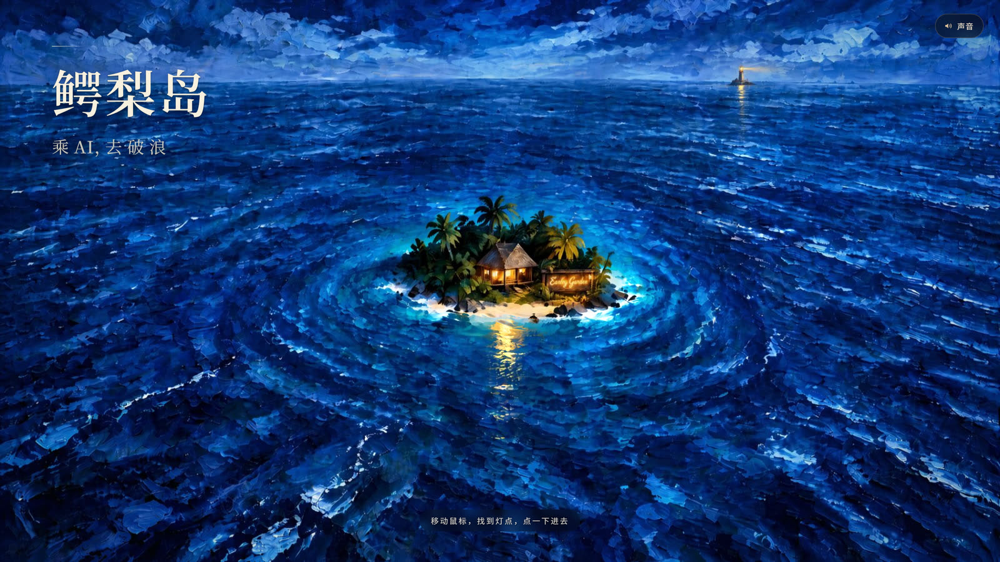
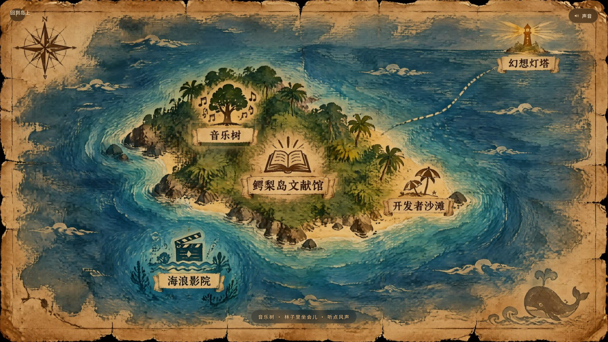
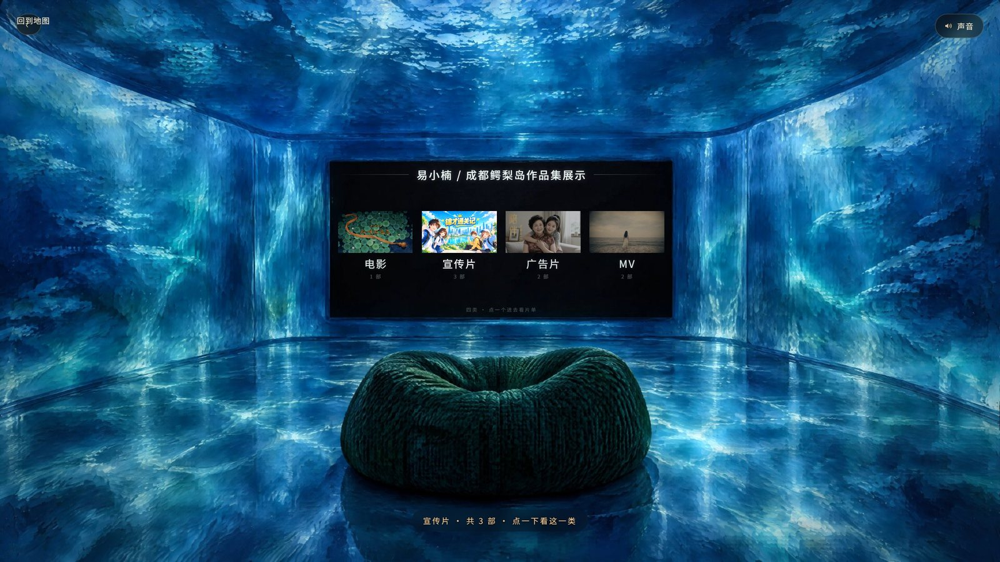
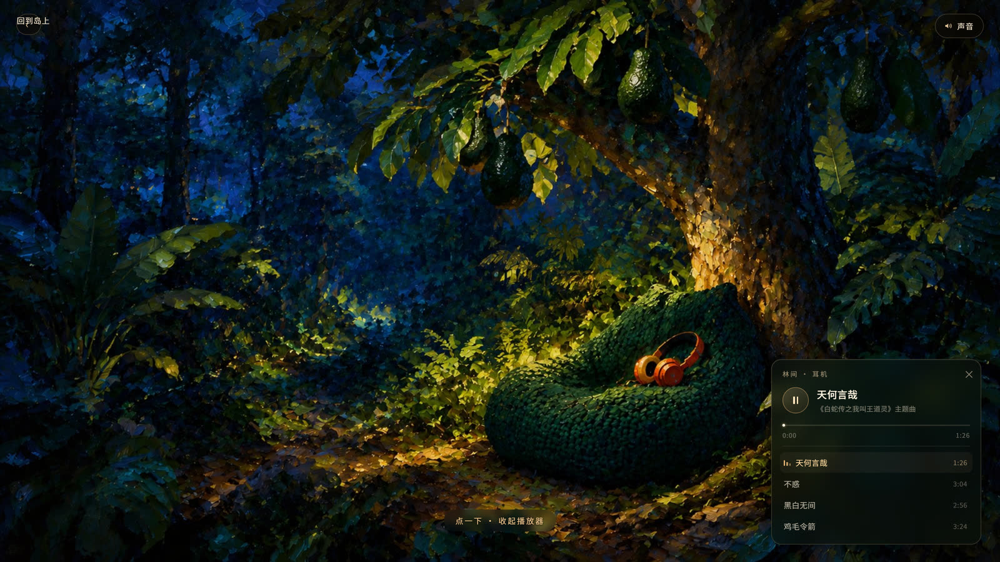
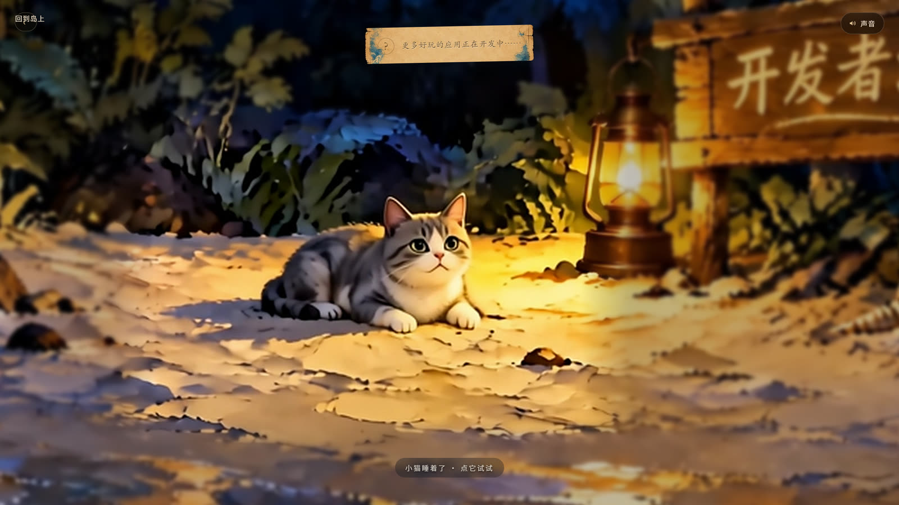
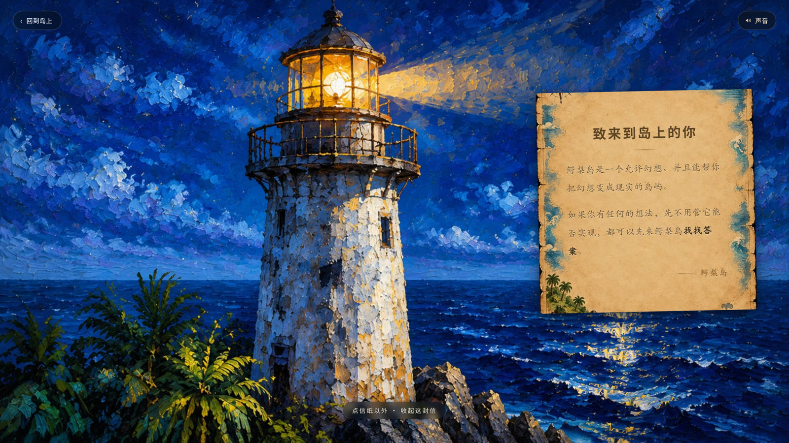

# 鳄梨岛 · 电子展厅

一座用网页搭起来的岛：**七个可以走进去的版块**，八部影片、四首配乐、九条报道。
原生 JavaScript + Three.js + Vite，无框架、无后端，纯静态托管。

**在线访问**：https://earleygarden.github.io/earleygarden/



---

## 一、版块

七个版块挂在同一条 hash 路由上，切换时不重新加载页面；除片源和音频外，整站就是一张 HTML 加几个 ES Module。

| 版块 | 路由 | 有什么 | 能做什么 |
|---|---|---|---|
| 序章 · 门口的海 | `#/garden` | 夜色中的小岛主图，水面与灯光倒影实时流动 | 热区灯点：木屋、灯塔、灯牌、林子、海、沙滩 |
| 鳄梨岛地图 | `#/map` | 手绘藏宝图，五个写着地名的地方 | 指到卷轴，暖光漫开并报出名字；点击进入 |
| 文献馆 · 木屋 | `#/cabin` | 木屋全景、桌上摊开的《鳄梨岛志》、窗外的月亮 | 点窗回岛上；点书进入细节，再点播翻页视频，尾帧留「易小楠」那一页，再点开信纸 |
| 海浪影院 · 水下放映厅 | `#/undersea` | 全集片单：电影 1 · 宣传片 3 · 广告片 2 · MV 2 | 幕上分两层：先四类，再片单；点封面在幕内放映，带进度、音量、全屏 |
| 林间 · 音乐树 | `#/grove` | 树下的绒面沙发与一副耳机，四首配乐 | 点耳机浮出播放器；出歌时环境声自动让路 |
| 开发者沙滩 | `#/beach` | 睡着的猫、真的海浪、写着「开发者沙滩」的木牌 | 点猫：镜头推近 2 倍，猫抬头睁眼，停一会儿再睡回去 |
| 幻想灯塔 | `#/garden/lighthouse` | 灯塔特写：塔身、礁石、海平线、月光倒影 | 就地铺满画面（不进路由），再点回岛上 |

深链接：`#/undersea/movie` 直接落在某一类片单（`movie` / `promo` / `ad` / `mv`），对外分享时可跳过四分类那一层。

**内容规模**

- 影片 8 部，1080p，站内直接播放（片源与 16:9 封面都在 `public/assets/cinema/`）
- 配乐 4 首，本地 mp3，不依赖任何外链
- 报道 9 条，收在信纸第一页，每条都能点开原文

| 地图 | 文献馆 | 海浪影院 |
|:--:|:--:|:--:|
|  |  |  |

| 林间 | 开发者沙滩 | 幻想灯塔 |
|:--:|:--:|:--:|
|  |  |  |

## 二、架构

### 技术选型

| 层 | 选择 | 说明 |
|---|---|---|
| 运行时 | 原生 ES Module | 无框架、无状态库、无 UI 组件库 |
| 渲染 | Three.js（唯一运行时依赖） | 三套着色器（水面、水下焦散、树叶）+ 旧版三维厅模板 |
| 构建 | Vite | 多入口、相对路径产出、静态资源按内容哈希命名 |
| 托管 | GitHub Pages + Actions | 推 `main` 即构建发布，没有服务端 |

### 分层

```
index.html           外壳：全部样式（CSS 变量、断点、各场景样式）+ #stage / #overlay / #fade 三个容器
src/
  main.js            入口：渲染器、hash 路由、场景挂载与销毁、转场、环境声调度
  scenes/            版块即模块
    intro.js           序章：主图 + 水面 + 热区 + 灯塔特写
    mapBoard.js        地图：图片坐标热区 + 暖光
    imageScene.js      通用「图片场景」工厂：文献馆、海浪影院、林间共用
    beach.js           沙滩：底图 + 视频层 + 猫
    reportLetter.js    信纸弹层：三页，可翻页
    room.js            旧版三维厅模板（五个厅共用一套房间工厂）
    garden.js          早期三维占位场景（保留，未接入路由）
  core/              可复用能力，与内容无关
    water.js           水面着色器：同心行波 + 陆地遮罩 + 灯影层
    aqua.js            水下焦散：只加光，不动形
    foliage.js         树叶摆动：四层噪声 + 风团包络
    ambience.js        环境声：实时合成的七床底噪 + 交叉淡变
    player.js          配乐播放器：自绘界面、淡入淡出
    reveal.js          灯点显隐：有动作才亮，安静两秒退场
    label.js           Three.js 场景里的 HTML 标签层
    capture.js         录屏模式（`?capture=1` 时动态加载）
  data/              内容与坐标：改文案、换图、加片子只动这里
public/assets/       插画、影片、音频、遮罩
docs/screens/        README 用截图
```

### 场景契约

每个场景模块返回同一个对象，`main.js` 只认这几个字段——加一个版块就是加一个模块，不动其它地方。

| 字段 | 作用 |
|---|---|
| `ui` | DOM 节点数组，被挂到 `#overlay` |
| `scene` / `camera` | Three.js 场景与相机；为 `null` 时这一帧不渲染 |
| `update(dt)` | 每帧调用：着色器时间、相机缓动、播放器进度都靠它推 |
| `resize(w, h, aspect)` | 窗口变化时重算 |
| `dispose()` | 卸载：撤事件、释放几何体与材质，不留孤儿 |
| `setView(sub)` | 可选。图内层级切换（如木屋全景 ↔ 书页），有它就不重新挂载、不走黑场 |

`mount()` 里有一处刻意的处理：转场途中再点一次不会丢请求，而是记进 `pending`，这一趟走完再补一次（后到的赢）。否则 `location.hash` 已经变了、`hashchange` 不会再触发，画面会永久停在上一间，只能刷新。

### 数据驱动

内容与坐标全部在 `src/data/`，场景代码里没有一个文案字面量。

| 文件 | 管什么 |
|---|---|
| `intro.js` | 主图尺寸、六个热区包围盒、两组水面参数 |
| `mapboard.js` | 地图上五个地方的包围盒与去向 |
| `cabin.js` | 木屋的两个视图、热区、返回层级 |
| `undersea.js` | 四类片单、放映区矩形、片源与封面路径 |
| `grove.js` | 四首曲目与耳机热区 |
| `beach.js` | 猫的位置、动作层矩形、推近原点 |
| `reports.js` | 九条报道、信纸三页的条目坐标 |
| `works.js` | 旧版五个三维厅的墙面配色与作品数据 |
| `base.js` | 资源前缀：`import.meta.env.BASE_URL + 'assets/'` |

坐标一律是**图片坐标**：左上 `(0,0)`、右下 `(1,1)`。布局由 JS 按原图原始比例算出，不靠 `object-fit` 裁切，所以窗口比例怎么变热区都不会漂。换一张插画，只改这里的数值（部分遮罩要重跑 `tools/` 里的脚本）。

### 渲染：让静图动起来的三种办法

插画是分层叠加的伪三维，不做 WebGL 建模。要它"活"，靠的是三套着色器，共同规矩是**只动该动的地方**：

1. **水面**（`core/water.js`）：主图当纹理，绕岛心做同心外扩行波。地平线以上完全静止；岸上靠 `land-mask.png` 冻结；灯光倒影单独一层，会被波纹切断、拉长、忽明忽暗。位移只有千分之几——「看见在动」主要靠明暗，不靠位移。
2. **水下焦散**（`core/aqua.js`）：房间一个像素都不位移，只在墙面、顶棚、地面叠一层缓慢游走的焦散。黑幕和沙发靠 `light-mask.png` 冻结，结构线不冻。
3. **树叶**（`core/foliage.js`）：四层噪声拉开快慢（风团 20 秒 → 枝条 8 秒 → 叶簇 3.5 秒 → 叶尖 1.3 秒），位移几个像素，明暗比位移更重；沙发、耳机、树干靠 `leaves-mask.png` 冻结。

沙滩是第四种：海浪和猫本来就是视频。`wave.mp4` 循环播放，猫那块用底图羽化贴死——浪是真的，猫在睡；点猫时再叠一条 `cat-awake.mp4`。

### 声音

- 七床底噪（海、拍岸、沙滩、林间、木屋、深海、地图）全部 Web Audio 实时合成，不落地成文件：噪声永不重复，换场景只是节点图上两个增益互相让位。
- 浏览器要求手势才能出声：进站先记下「想去哪一床」，第一次点击或按键才真正开始。
- 转场时声音先等黑场盖住屏幕再换，交叉淡变 1.5 秒，比画面 0.43 秒的黑场长——声音不能比画面先跳。
- 放歌时底噪让到 0.34，人声不跟虫鸣打架。

### 交互约定

- 灯点是主要提示，不是装饰：鼠标有动作才淡入，静两秒退回画里；灯灭了，命中判定照旧有效。
- 鼠标移动只做提示（亮灯、换底部文案），换场景一律靠点击。
- 命中走坐标，不依赖 DOM 元素，任何窗口比例下都点得中。
- 左上角按钮 / `Esc` 逐级返回；从哪进去就回哪去（影院、沙滩各记一个来源）。

## 三、目录

```
public/assets/
  intro/      主图、灯塔特写、灯牌、两张遮罩、信纸底
  map/        手绘藏宝图
  cabin/      木屋全景、书页、翻页视频、报道版面图
  undersea/   放映厅全景、光遮罩
  cinema/     films/ 8 部 mp4 · covers/ 8 张 16:9 封面
  grove/      林间全景、叶遮罩、audio/ 4 首 mp3
  beach/      沙滩底图、wave.mp4、cat-awake.mp4
```

## 四、本地运行

```bash
npm install
npm run dev      # http://127.0.0.1:5180
npm run build    # 产出 dist/
npm run preview  # 本地预览构建产物
```

## 五、发布

推送到 `main` 即由 GitHub Actions 构建并发布到 GitHub Pages（`.github/workflows/deploy.yml`）。

仓库名不是 `<用户名>.github.io`，站点因此挂在 `/earleygarden/` 子路径下。资源路径统一从 `src/data/base.js` 取前缀，`vite.config.js` 里 `base: './'`——换仓库名或换托管都不用改代码。

## 六、作者

**易小楠**（鳄梨）· 成都鳄梨岛文化科技创始人 · Base 成都
高级工程师出身，做过项目总工，也做过一家公司的一号位。2026 年起用 AI 做内容，也把 AI 用进生意里。
代表作：80 分钟 AIGC 动画长片《白蛇传之我叫王道灵》。本站是她的作品展厅。
