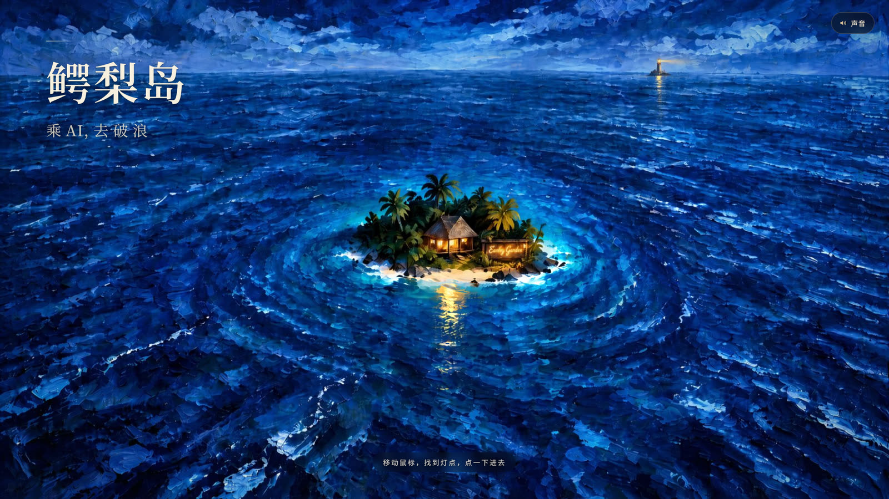
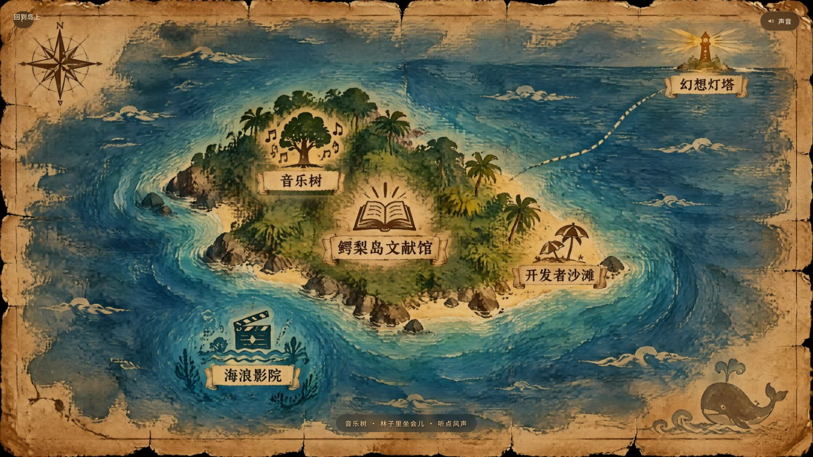
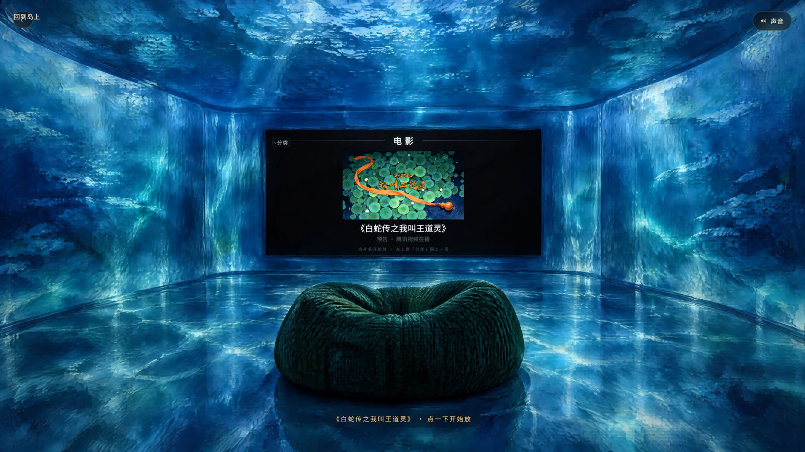
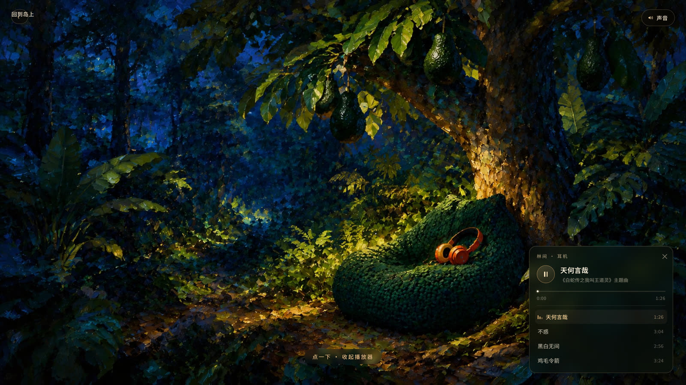
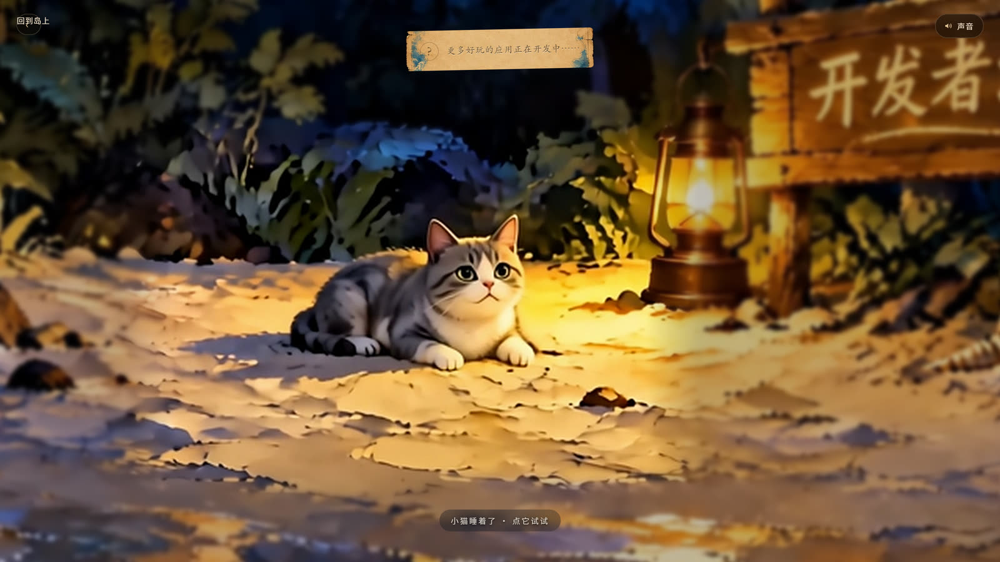
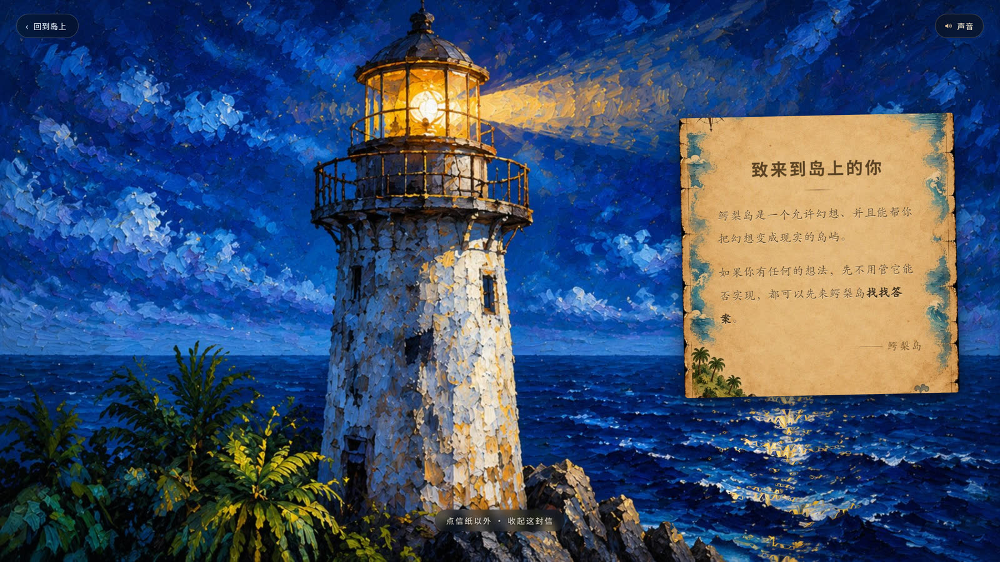

# 鳄梨岛 · 电子展厅

**易小楠**（鳄梨导演）· 成都鳄梨岛文化创始人

做 AI 商业项目：AIGC 内容与商业策划。前高级工程师，做过项目总工，也做过一家公司的一号位。

2026 年一个人、一套 AI 工具，一个月完成 80 分钟动画长片《白蛇传之我叫王道灵》——登陆腾讯视频当天盈利，连续十天动画榜第一，新华社、环球时报、四川日报报道。

[完整经历见文末 ↓](#关于)

---

一间为动画作品建的线上展厅。没有商品页、没有轮播图，只有七个可以走进去的房间：
门口的海、一张地图、一间文献馆、一座影院、一棵会唱歌的树、一片沙滩，和一盏灯塔。

手写原生 JavaScript（没有框架）+ Three.js + Vite。场景插画、环境声合成、翻页影片、
播放器、信纸，全部是这个项目里做出来的。

**在线访问**：https://earleygarden.github.io/earleygarden/



---

## 七个去处

| 地图 | 鳄梨岛文献馆 |
|:--:|:--:|
|  |  |
| 一张手绘岛图，鼠标扫过会亮起去处 | 点开书，书会翻页；翻到的那一页夹着一封信 |

| 海浪影院 | 音乐树 |
|:--:|:--:|
|  |  |
| 片单、分类、放映。放的是自己的片子 | 配乐挂在树上，摘下耳机就响 |

| 开发者沙滩 | 幻想灯塔 |
|:--:|:--:|
|  |  |
| 一只猫。点它会抬头 | 点灯，展开一封写在信纸上的话 |

## 做了什么

**动画作品**

- 《白蛇传之我叫王道灵》—— 80 分钟 AIGC 动画长片，中国水彩风格。2026 年 6 月 19 日经北京国际电影节相关渠道登陆腾讯视频电影频道，上线后连续 10 天位列动画榜第一。
- 站内影院收录了若干片段与预告。

**这个展厅本身**

- 场景是插画分层叠加的伪三维：鼠标移动时各层以不同速度位移，做出纵深，不用 WebGL 建模。
- 环境声是 Web Audio 实时合成的，不是音频文件——海潮、风、远处的钟，都由振荡器和滤波噪声搭出来，所以能随场景无缝过渡。
- 播放器的音量、淡入淡出、进度都自己写，因为原生的 `<audio>` 控件放不进这间屋子。
- 翻页是影片，播完停在尾帧不动，你看到的就是"翻过去的那一页"。
- 全站只有一个 HTML 文件，靠 hash 路由切换场景，所以放在任何静态托管上都能直接跑。

## 本地运行

```bash
npm install
npm run dev      # http://127.0.0.1:5180
```

构建：

```bash
npm run build    # 产出 dist/
```

## 部署

推送到 `main` 分支即由 GitHub Actions 自动构建并发布到 GitHub Pages（见 `.github/workflows/deploy.yml`）。

仓库名不是 `<用户名>.github.io`，站点因此挂在 `/earleygarden/` 子路径下。资源路径统一由
`src/data/base.js` 取前缀（`vite.config.js` 里 `base: './'`），换仓库名或换托管都不用改代码。

## 目录

```
index.html          全站样式与结构（单页）
src/
  main.js           入口与路由
  core/             场景调度、音频、播放器、转场
  scenes/           七个场景各自的实现
  data/             作品、片单、曲目、报道等数据
public/assets/      插画、影片、音频
docs/screens/       README 用的场景截图
```

---

## 关于

**易小楠**（鳄梨导演）
<br>成都鳄梨岛文化科技有限公司 创始人 · Base 成都
<br>高级工程师，工学硕士

工程师出身。做过项目总工，也做过一家公司的一号位。
2026 年 5 月辞职，现在用 AI 做内容，也把 AI 用进生意里。

**2011 — 2021　工程设计咨询（体制内）**

七年一线专业岗，做到项目总工，主持过多项成都市级重大规划与市政项目，拿过若干省市级奖项。
后三年转一线管理，任院长助理，管行政、人事、品牌。

**2021 — 2026 年 5 月　国企创业公司 1 号位**

从 0 到 1 搭起这家公司的管理体系与业务体系，主攻城市营销策划、商业策划、闲置空间运营。
存续期间开发十余个商业模式，全部跑完闭环。

**2026 年 5 月 — 至今　自己做**

辞职后转向 AI 商业项目：两个月内做成两个 AIGC 方向的项目闭环。
自学 AI 一个月，独立完成 80 分钟动画长片《白蛇传之我叫王道灵》，2026 年 6 月登陆腾讯视频——
国内第一部由一人剧组独立完成全流程的网络电影。上线当天实现盈利，连续十天位列动画榜第一，
新华社、环球时报、四川日报等媒体报道。

现状：佛系创业。接商业策划类项目，凭喜好接 AIGC 商业订单，同时在 AI 的多个方向上做探索；
也是 OPC 天使投资人。

核心能力：商业策划 + 企业管理实战。热爱动手实践。

